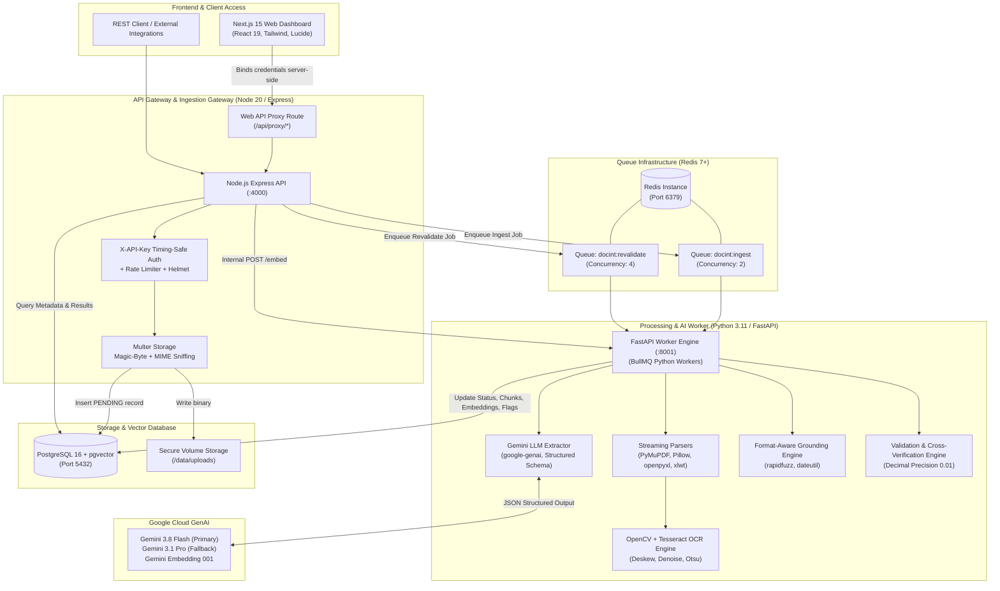
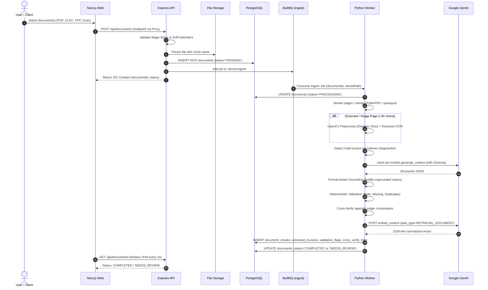
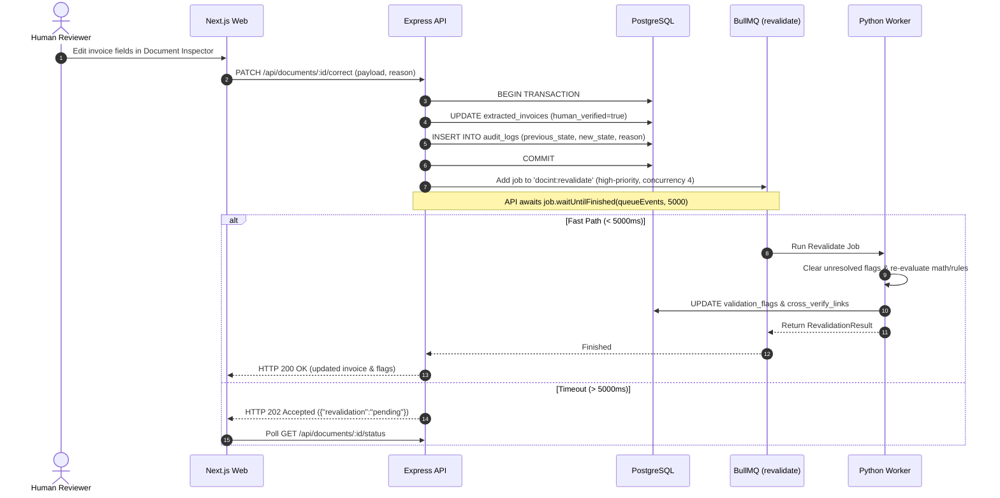
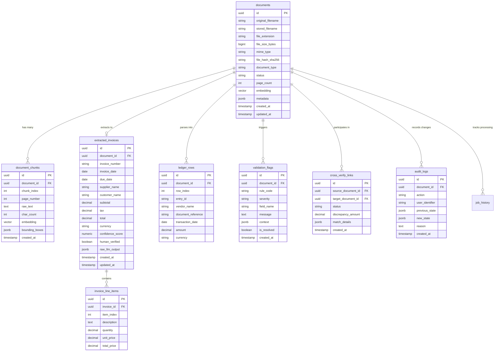

# System Architecture & Technical Specifications

The **AI-Powered Document Intelligence System** is an enterprise-grade document ingestion, extraction, cross-verification, and auditing platform engineered for high-throughput financial and healthcare document processing.

---

## 1. High-Level System Architecture

---

## 2. Ingestion Pipeline Sequence

---

## 3. Manual Correction & Revalidation Sequence

---

## 4. Entity-Relationship (ER) Diagram

---

## 5. Architectural Guarantees & Trade-offs

1. **Single Source of Truth for Business Logic:** All validation rules, math checks, and cross-verification routines live exclusively in Python (`services/worker/app/validator/`). The Node API never duplicates or re-implements validation algorithms.
2. **Corrupted File Isolation:** A broken stream or corrupted header raises `CorruptedDocumentError` inside the worker, records `status = 'FAILED'`, and completes the queue job normally. Subsequent jobs in the queue are never stalled.
3. **Queue Segregation:** Long, resource-intensive OCR and LLM extraction jobs run on `docint:ingest` (concurrency 2). Fast revalidations and user corrections run on `docint:revalidate` (concurrency 4). A slow 1,000-page ingest will never block a human reviewer awaiting a revalidation.
4. **Security & Sandbox Isolation:** The API never exposes the internal worker or database to the public Internet. The Next.js frontend connects via a server-side API proxy route that securely binds `X-API-Key`.
